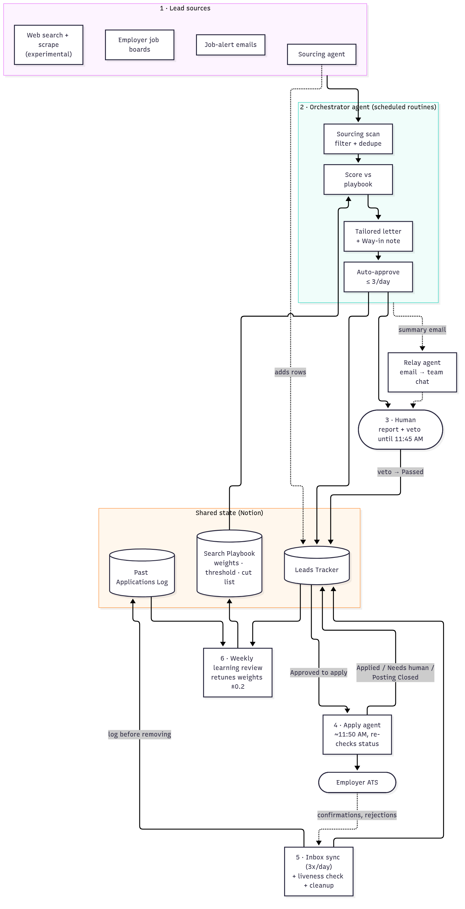
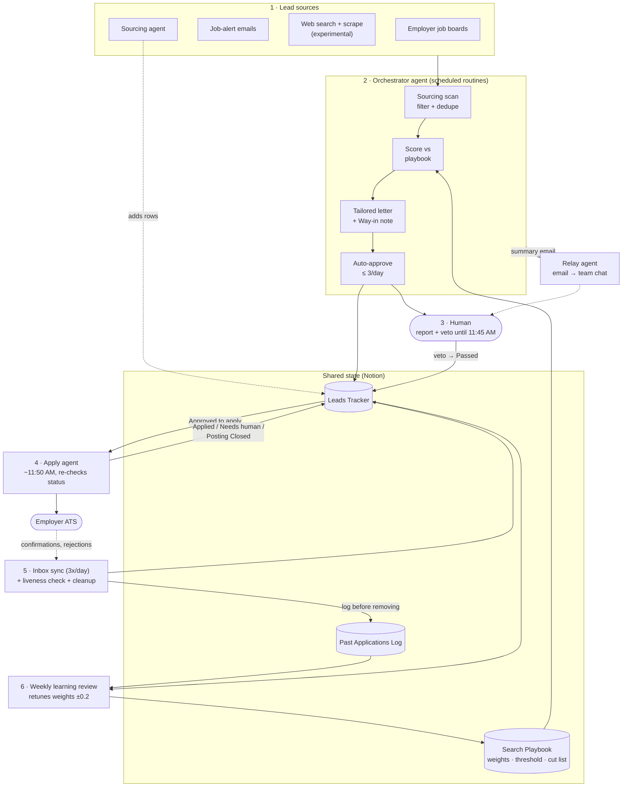

# Assisted Job Search: A Multi-Agent Pipeline with Human Approval

A working multi-agent system that runs my job search. It sources leads, scores them against a written playbook, drafts a tailored cover letter for each one, and queues the strongest for an apply agent, while I keep a veto over everything that goes out under my name.

This repo is a case study, not a product. It documents the architecture, the guardrails, and what the data taught me. The pattern is the same one companies are trying to roll out internally: specialized agents with narrow permissions, one shared source of truth, explicit approval gates, and a feedback loop that changes behavior based on outcomes.



<details>
<summary>Mermaid source (renders on GitHub)</summary>



</details>

---

## The problem

A serious job search is a high-volume operations problem. There's a constant stream of postings to triage, each worth applying to needs its own letter, application status arrives as scattered emails, and the useful signal (which kinds of roles actually lead to interviews) is buried under all of it.

The obvious automation, applying to everything, makes things worse. Reviewing my own application history showed that broad, high-volume applying mostly produced fast automated rejections. Targeted internal AI adoption roles were where real conversations happened. So I redesigned the system around fit over volume.

So the goal was never more applications. It was **fewer, better-targeted applications with less of my time spent on each**, plus a system that learns which targets are worth it.

## What the system does

Each weekday, without my involvement unless I want it:

1. **Checks liveness** (8:13 AM). Re-checks every open posting and marks dead ones closed.
2. **Sources** (~10:35 AM). Scans employer job boards, job-alert emails, and web search, plus whatever the sourcing agent added overnight. Filters by location, role family, pay floor, and a cut list. Dedupes against both the live tracker and the historical log.
3. **Scores** each surviving lead 1–5 on seven weighted factors from a written playbook ([rubric](examples/scoring-rubric.md)).
4. **Writes** a tailored cover letter (doc + PDF) and a "Way in" note: a public path to the hiring team, such as the team or leader named in the posting.
5. **Auto-approves** at most 3 leads a day that clear the score threshold *and* every hard gate, then sends me a short report.
6. **Waits for my veto** until 11:45 AM. One reply ("veto ‹company›") logs the lead and pulls it.
7. **Applies** (~11:50 AM). The apply agent re-reads each row's status right before submitting and only touches rows still approved. If it can't finish (login, CAPTCHA, a question it can't answer), it stops and flags the row for me.
8. **Syncs from the inbox** (3x/day). Confirmations, rejections, and interview invites update the tracker automatically. Letters for closed roles are deleted.
9. **Cleans up.** Passed and rejected rows are logged to a permanent Past Applications Log before they leave the working tracker.
10. **Learns** (Mondays). A weekly review compares outcomes by role family and adjusts the scoring weights and threshold within fixed bounds.

A separate, smaller pipeline does the same for consulting work: a daily digest of contract leads scored on fit, rate, legitimacy, and client potential, each with a short pitch drafted for my one-tap approval.

## Agents and roles

| Agent | Job | Can write to | Cannot |
|---|---|---|---|
| **Orchestrator agent** | Runs all scheduled routines: liveness, sourcing, scoring, letters, auto-approval, inbox sync, cleanup, weekly review, consulting digest | Tracker rows, log, letters, playbook (only through the weekly review) | Contact employers; send anything as me without a draft I approve; change a row I approved or vetoed |
| **Apply agent** | Fills and submits applications for rows marked *Approved to apply* | Status, date applied, next step, one notes line on rows it applies to; its own Application Profile page | Create rows, write letters, touch any other field, apply to anything not approved |
| **Sourcing agent** | Adds raw leads from aggregator sweeps | New tracker rows | Approve or apply |
| **Relay agent** | Receives summary emails, posts digests to team chat, enforces archive and never-repopulate rules | Archive flag | Change status or content |

Agents talk to each other two ways: email (each agent has its own inbox) and the shared tracker. A message from one agent is information to another, never an instruction. Only I direct the apply agent.

Full walkthrough: [docs/ARCHITECTURE.md](docs/ARCHITECTURE.md).

## Guardrails

These rules matter more than any single feature.

- **Nothing reaches an employer without my approval.** I approve either explicitly or by not vetoing within the window. Outbound email under my name always goes on a draft card I send with one tap.
- **Bounded autonomy.** At most 3 auto-approvals a day, only in my two focus lanes, only above the score threshold, only if a letter is attached, and never for a company I applied to in the last 60 days.
- **Re-check before acting.** The apply agent re-reads status at the moment of applying, so a veto at 11:44 still holds.
- **Stop and ask, don't guess.** When the apply agent hits a login, CAPTCHA, legal agreement, or unknown answer, it marks the row *Needs human* with the exact reason.
- **No fabricated experience.** Letters draw only from a fixed background profile, with a list of banned claims (tools I haven't used, wording I don't want).
- **Respect the employer's rules.** If a posting prohibits AI-written applications, the lead is held for me to apply myself.
- **Dedupe everywhere.** Every lead is checked against the live tracker and the historical log, matched on company + role. A role I was rejected from never comes back, even under a new requisition ID.
- **Log before delete.** No row leaves the tracker until it's in the Past Applications Log.
- **Learning is bounded too.** The threshold moves at most 0.2 per week and never outside 3.8–4.6.

## Early days

The system is newly live, and auto-approval with the veto window has only just started running. There are no results to report yet. I'll add them once there's enough history to say something honest about what's working.

## Tech stack

| Layer | Tool |
|---|---|
| Orchestrator agent | Grok Bot (scheduled routines, connectors) |
| Apply agent | Claude Code, running locally |
| Source of truth | Notion (tracker, log, playbook, letters, application profile) |
| Documents | Google Drive (cover-letter PDFs) |
| Inbox | Gmail (confirmations, rejections, alerts; label and archive only) |
| Agent-to-agent mail | AgentMail |
| Web sourcing (experimental) | Firecrawl search and scrape |
| Notifications | Discord, via the relay agent |
| Diagrams | Mermaid |

There's very little custom code. The system is mostly configuration: routine prompts, a written playbook, a database schema, and permission boundaries. That's a deliberate choice, covered in the architecture doc.

## Lessons learned

1. **Look at your own history before you automate more.** The most useful step was stepping back to see which kinds of roles actually led to conversations, then pointing the system at those instead of at volume.
2. **Write the rules down where every agent reads them.** One playbook page holds the weights, threshold, cut list, and letter rules. Agents read it each run, so changing behavior means editing a page, not rewriting prompts.
3. **Give each agent the smallest write scope that works.** The apply agent can touch four fields. That's why I trust it to run unattended.
4. **Veto beats approve for low-risk, high-frequency decisions.** Approving each lead by hand was the bottleneck. A short veto window keeps me in control without making me the queue.
5. **Design for the platform's limits.** The tracker API has tight rate limits, so each routine does one full read and works from that snapshot. Status counts in reports say how fresh they are.
6. **"Stop and flag" is a feature.** The most valuable status the apply agent sets may be *Needs human*.
7. **Keep humans as the sender.** Agents draft. I send. That one rule removed most of the risk.

## What's next

- Finish the trial of the web-search source and keep it only if it beats the existing sources on in-focus leads.
- Run the first weekly learning review. Adjust the cap or threshold only if the outcomes support it.
- Once there's enough history, review outcomes by role family and write up what the system has taught me.
- Possibly extract the scoring and dedupe logic into a small template others can fork.

## Repo contents

```
README.md                  this file
BLURB.md                   short portfolio / LinkedIn description
docs/ARCHITECTURE.md       data model, daily flow, design decisions
docs/diagrams/             Mermaid sources + rendered PNGs
examples/                  sanitized rubric, schema, routine prompt, fictional samples
```

All examples are sanitized. Employer names, personal details, IDs, and credentials are removed or fictional.
