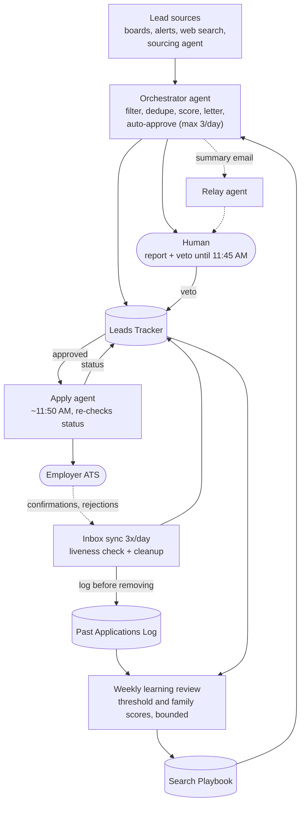
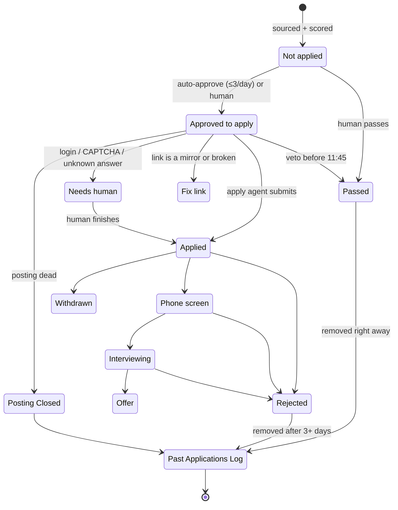
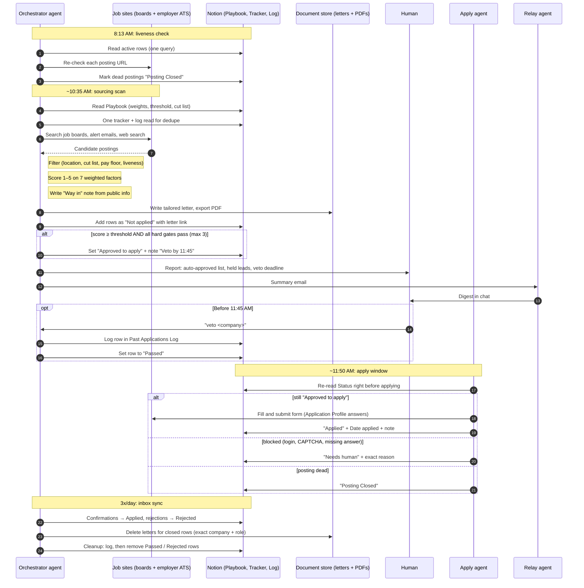

# Architecture

This document walks through how the pipeline is built and why. For the short version, see the [README](../README.md).

- [1. Design goals](#1-design-goals)
- [2. Components](#2-components)
- [3. Data model](#3-data-model)
- [4. The daily flow](#4-the-daily-flow)
- [5. Design decisions](#5-design-decisions)
- [6. Failure handling](#6-failure-handling)
- [7. The consulting pipeline](#7-the-consulting-pipeline)
- [8. What I'd change](#8-what-id-change)
- [9. Threat model](#9-threat-model)

---

## 1. Design goals

1. **Quality over volume.** Spend applications where conversations happen.
2. **The human stays the decision-maker.** Agents propose and prepare. I approve, by default through a veto window.
3. **One source of truth.** Every agent reads and writes the same tracker. No agent keeps private state that others depend on.
4. **Least privilege.** Each agent can write only the fields its job needs.
5. **Rules as data.** Weights, thresholds, cut lists, and writing rules live on a page the agents read every run, not buried in prompts.
6. **Learn from outcomes, within bounds.** The system can tune itself, but only slowly and only inside limits I set.

## 2. Components

| Component | What it is |
|---|---|
| **Orchestrator agent** | A hosted assistant agent running scheduled routines. It owns sourcing, scoring, letters, auto-approval, inbox sync, cleanup, the weekly review, and the consulting digest. It talks to me in chat and uses connectors for the tracker, documents, and inbox. |
| **Apply agent** | A coding agent running locally on my computer with browser access. It applies only to rows marked *Approved to apply*, using answers from an Application Profile page. |
| **Sourcing agent** | A separate agent that sweeps aggregators and adds raw rows to the tracker. |
| **Relay agent** | Receives summary emails from the other agents, posts digests to team chat, runs the archive pass, and enforces the never-repopulate rule on every sweep. |
| **Search Playbook** | A page holding scoring weights, the auto-approve threshold and bounds, hard gates, role-family history, the cut list, letter guidance, and a changelog. |
| **Leads Tracker** | The working database of active leads. |
| **Past Applications Log** | A permanent record of every lead that leaves the tracker, used for dedupe and outcome analysis. |
| **Cover letters** | One page per active lead, plus a PDF in a document store, linked from the tracker row. |
| **Application Profile** | Standard answers for application forms (work authorization, links, salary expectations). Only the apply agent edits it. |

## 3. Data model

### Leads Tracker

Full schema with field descriptions: [examples/leads-tracker-schema.md](../examples/leads-tracker-schema.md).

Key fields: Company, Role, Link, Location, Salary, Posted, Source, Fit (score and lane), Rank, Red flags, Cover Letter (URL), Resume version, Apply route, Status, Date applied, Next step, Notes, Archive.

### Status lifecycle

Two ownership rules keep agents from stepping on each other:

- **Approved to apply** belongs to me and the apply agent. Other agents count it like *Not applied* for reporting but never set, change, or clear it. The only exception is carrying out my veto.
- **Needs human** is set by the apply agent and then belongs to me. Other agents leave those rows alone.

### Past Applications Log

A slimmer record: Company, Role, Posting URL, Final Status (*Rejected*, *Posting Closed*, *Withdrawn*, or *Passed*), Date applied, Rejected/closed date, Removed on, and Notes (including the reason for a pass). It's append-only in practice. Dedupe checks it on every sourcing run, so a lead I already passed on or was rejected from doesn't come back.

## 4. The daily flow

### 4.1 Liveness check (weekdays, 8:13 AM)

The orchestrator reads active rows once and re-checks each posting URL. Dead postings become *Posting Closed*. This runs before sourcing so the morning report never recommends a role that's already gone.

### 4.2 Sourcing (~10:35 AM)

Inputs:

- Employer job boards (ATS pages) for target titles and employer types
- Job-alert emails in the inbox
- Web search and scrape (experimental; see [5.9](#59-new-sources-run-as-experiments))
- Rows the sourcing agent added since the last run

Filters, in order, before any scoring:

1. **Location.** Target metros or remote US. A strong fit in the primary lane may be anywhere in the US.
2. **Cut list.** Role families that didn't lead to conversations in my history, plus staffing-agency postings, are dropped outright.
3. **Pay floor.** Posted pay well below the floor is dropped. Unposted pay is allowed but scores lower.
4. **Liveness.** The posting must be open on the employer's own board.
5. **Dedupe.** Match company + role against the tracker and the log.

### 4.3 Scoring

Each lead gets a 1–5 score on seven factors, combined as a weighted average:

| Factor | Weight |
|---|---|
| Lane fit | 0.25 |
| Role-family history | 0.25 |
| Seniority match | 0.15 |
| Location | 0.10 |
| Pay vs. floor | 0.10 |
| Way-in strength | 0.10 |
| Posting freshness | 0.05 |

Half the weight is on lane and role-family history because that's the clearest signal from my own history: targeted internal AI adoption roles were where conversations happened. Full rubric: [examples/scoring-rubric.md](../examples/scoring-rubric.md).

### 4.4 Cover letter and Way-in note

For every lead that's added, the orchestrator writes:

- A **tailored letter** as a page, plus a PDF export, linked on the row. Letters follow fixed writing rules: draw only from a fixed background profile, use the angle that matches the lane, avoid banned words and claims, and never invent tools or experience.
- A **Way-in note** built from public information only: the team named in the posting, who the role reports to, whether the posting refuses agencies. It's research for me. Agents never contact anyone it names.

### 4.5 Auto-approval

A lead is auto-approved only if **all** of these hold:

- It's in one of the two focus lanes.
- Its location is allowed.
- Its score is at or above the threshold (starting at 4.2).
- The posting is live.
- A cover-letter PDF is linked.
- The role isn't in a cut family.
- There's been no application to the same company in the last 60 days.

At most 3 rows per day. The row's status becomes *Approved to apply*, with a note recording the date, the score, and the veto deadline.

Strong leads that miss a gate (an off-list location, or an employer that bans AI-written applications) are **held for me**, not auto-approved, and called out in the report.

### 4.6 Report and veto window (until 11:45 AM)

The report is short: what was auto-approved and why, what was held and why, and the veto deadline. A one-line reply ("veto ‹company›") makes the orchestrator log the row and set it to *Passed*.

### 4.7 Apply (~11:50 AM)

The apply agent:

1. Re-reads each row's status **at the moment of applying**.
2. Skips anything no longer *Approved to apply*.
3. Fills the form from the Application Profile and attaches the row's letter and resume version.
4. On success: *Applied*, today's date, and one notes line starting "Applied by apply agent".
5. On a blocker: *Needs human*, with the exact reason in Next step.
6. On a dead or mirror link: *Posting Closed* or *Fix link*.

### 4.8 Inbox sync (3x/day)

The orchestrator reads new mail and maps it to rows:

- Confirmations → *Applied*. A confirmation with no matching row creates one.
- Rejections → *Rejected*. The letter page and PDF are deleted, but only on an exact company + role match.
- Interview invites → flagged to me immediately.

Job mail is labeled and archived. The inbox is otherwise read-only to agents.

### 4.9 Cleanup

- *Passed* rows: logged to the Past Applications Log, then removed right away.
- *Rejected* rows: archived from the working view after 2 days, logged and removed after 3+ days.
- Letters for passed, rejected, or closed roles are deleted.

Nothing is removed before it's logged.

### 4.10 Weekly learning review (Mondays)

The review reads new outcomes (interviews, rejections, vetoes, *Needs human* reasons, and notes from the apply agent) and proposes changes to the playbook:

- Role-family scores move only when there are new outcomes in that family.
- The threshold moves at most 0.2 per week, within 3.8–4.6.
- Every change goes in the playbook's changelog with the data behind it.
- Bigger questions, like changing the daily cap or reopening a cut family, go to me as proposals.

## 5. Design decisions

### 5.1 Veto window instead of approve-each

Hand-approving every lead made me the bottleneck, and the queue backed up. Fully autonomous applying would remove me from decisions that carry my name. A veto window sits between the two: the system acts by default on a small, high-confidence set, and I get a fixed window to say no. The window is short enough to keep the day moving and long enough to read a three-line report.

The safety rests on the apply agent's **re-check at the moment of applying**. Without it, a veto could race the apply run.

### 5.2 Dedupe against tracker *and* log

The tracker only holds active rows. If dedupe checked only the tracker, every passed or rejected lead would come back as new once it was cleaned up. Checking the permanent log as well makes "I already decided on this" stick. Matching is on company + role, not company alone: a rejection for one role doesn't block a different role at the same company. A rejected requisition never comes back, even with a new ID or date.

### 5.3 Caps per run

Three auto-approvals a day is deliberately small. High-volume applying mostly produced fast rejections, and a small cap keeps each application tailored. It also limits the damage if scoring drifts. The cap is a playbook value the weekly review can propose changing.

### 5.4 Lane quotas

Weekly volume is split by lane: at least 60% in the primary lane, small fixed allowances for secondary lanes, and a review date for the weakest one. Quotas keep the system from drifting toward whatever is most plentiful in the feeds, which tends to be senior product roles outside my focus.

### 5.5 A cut list, not just low scores

Some role families never led to conversations. Scoring them low still lets a high-paying, fresh posting sneak over the line. Cutting them outright is simpler and more honest. The same goes for staffing-agency postings.

### 5.6 Way-in enrichment

The conversations I've had came from roles I found and pursued myself, not from automated sweeps. The Way-in note is how the system tries to close that gap: it gives me a credible, public path to a person, which I can choose to use. It's also a scoring factor, so leads with a real path rank higher.

### 5.7 Rules on a page, not in prompts

Routine prompts are short and point to the playbook. Changing a weight, adding a banned phrase, or tightening a gate means editing one page, and every agent picks it up on its next run. The changelog shows when and why each rule changed.

### 5.8 Least-privilege write scopes

The apply agent is the riskiest component because it submits forms under my name. It can write four fields on rows it applies to, plus its own profile page. It can't create rows, write letters, or touch other columns. The narrow scope is what makes unattended runs acceptable.

### 5.9 New sources run as experiments

A web search-and-scrape source was added as a **time-boxed test** with a fixed end date. Its leads are tagged by source, so the comparison at the end is simple: in-focus leads per day, average score, and how many cleared auto-approval, versus the existing sources. It stays only if it earns its place. It also enriches Way-in notes, but with no outreach to anyone it surfaces.

### 5.10 Agents communicate through email and the tracker

Each agent has its own inbox. Summaries and handoffs go by email, and state goes in the tracker. Messages from one agent are **information** to another, never commands. Only I direct the apply agent. This keeps a confused or compromised agent from steering the others.

## 6. Failure handling

| Failure | Handling |
|---|---|
| **Tracker API rate limits** | One full tracker read per run, capped at a fixed row count. The run works from that snapshot. Reports state how fresh their counts are, and estimates are labeled as estimates. |
| **Apply run doesn't fire** (computer asleep, agent not running) | Rows stay *Approved to apply*. Nothing is lost. The next run or session picks them up, and the orchestrator reports the gap. |
| **Form blocker** | *Needs human* + exact reason. No guessing on legal agreements or unknown answers. |
| **Dead or mirror link** | *Posting Closed* or *Fix link*. Mirrors are replaced with the employer's own board. |
| **Duplicate lead from another agent** | Flagged "do not approve or apply" and left for me to delete. |
| **Employer bans AI-written applications** | Held for me, and the apply agent is told to skip it. |
| **Ambiguous email match** | No status change. Flagged for me. |
| **Letter deletion** | Only on an exact company + role match, so a rejection never deletes the wrong letter. |

## 7. The consulting pipeline

A separate pipeline (separate tracker, separate labels) looks for contract and fractional AI work:

- **Daily digest** of leads scored 1–5 on fit, rate, legitimacy, and client potential. Only leads at 3.5+ are surfaced.
- **Rate floor.** Anything below it is logged but not pitched.
- **Draft pitches** under 150 words: their problem, one or two relevant proofs, the approach, a next step.
- **One-tap send.** Pitches go to me as draft cards. Nothing is submitted, no bids are bought, and no terms are accepted without my approval.
- **Scam filters**: upfront payment, a quick move to encrypted chat apps, or unpaid spec work.
- **Cross-pipeline dedupe**: the same company is flagged if it shows up in both pipelines.

## 8. What I'd change

- **Record source on every row from day one.** Most historical rows don't say where they came from, which limits the analysis.
- **Structured scores.** Score and lane currently live in a text field. Numeric fields would make the weekly review easier.
- **A real event log.** Status changes are visible, but not who changed what and when, beyond notes lines.
- **Fewer agents writing rows.** Two agents creating rows means dedupe has to run in two places.
- **An independent check on auto-approval.** The orchestrator scores, writes the letter, and approves its own output. A second, narrower reviewer agent or a rules-only gate check would separate those duties.
- **More signal before tuning.** At a few applications a week, outcome counts are small. The weekly review should hold changes until a role family has enough outcomes to mean something.

## 9. Threat model

See [THREAT-MODEL.md](THREAT-MODEL.md).
